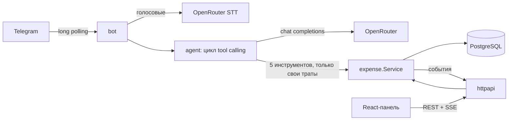

# Семейные расходы — Telegram-бот с ИИ-агентом и веб-панель

Член семьи пишет боту «кофе 350» (текстом или голосом) — трата сохраняется с суммой, категорией и датой. Глава семьи видит траты всех в веб-панели, которая обновляется в реальном времени.

## Запуск за 3 шага

Нужны Docker с compose и два секрета: токен бота и ключ LLM.

1. Скопируйте настройки и заполните `.env`:
   ```bash
   cp .env.example .env
   ```
   Обязательные ключи: `TELEGRAM_TOKEN` (от @BotFather), `LLM_API_KEY` (ключ [OpenRouter](https://openrouter.ai/keys)), `LLM_MODEL` (в примере уже указана модель) и `FAMILY_MEMBERS` — Telegram ID членов семьи в формате `ID:Имя` через запятую. Свой ID узнаёт любой посторонний, написав боту: он ответит, что семья его не знает, и покажет ID.
2. Запустите три сервиса — `postgres`, `backend` (порт 8080) и `frontend`:
   ```bash
   docker compose up --build
   ```
3. Откройте панель: http://localhost:3000 и напишите боту.

Демо-данные: `make seed` (то же, что `SEED_DEMO=true docker compose up -d --build backend`) заполняет панель тратами за 60 дней, если таблица пуста.

## Что умеет бот

| Сообщение | Что происходит |
|---|---|
| «кофе 350», «такси 1200 вчера», 🎤 «обед четыреста» | добавляет трату |
| «сколько потратил на еду в этом месяце», «покажи траты за неделю» | считает и показывает |
| «последнее было не 350, а 450» | исправляет по контексту диалога |
| «удали такси» | если такси несколько — переспросит, какое |
| чужой Telegram-аккаунт | вежливый отказ с ID для добавления |

Каждый член семьи видит и меняет только свои траты — это гарантирует код, а не промпт (см. «Безопасность»).

## Веб-панель

- Фильтры по периоду, члену семьи и категории (сохраняются в URL).
- KPI, траты по категориям и по дням, сравнение с прошлым периодом.
- Создание, редактирование, удаление; ошибки валидации — у нужного поля.
- Живые обновления через SSE: трата из бота появляется с подсветкой и уведомлением.
- «Журнал агента»: каждый запрос к боту, вызванные инструменты, токены и задержка.
- Светлая и тёмная темы, адаптивная вёрстка.

## Архитектура



- **Go-бэкенд** (`backend/`): один бинарь — REST API и бот над общим `expense.Service`. Postgres + sqlc, миграции goose, REST генерируется из `api/openapi.yaml` (oapi-codegen).
- **Агент** (`backend/internal/agent`): собственный цикл tool calling (до 6 шагов), инструменты `add_expense`, `find_expenses`, `get_summary`, `update_expense`, `delete_expense`. Периоды («на этой неделе») вычисляет код, история диалога — последние 20 сообщений за 6 часов.
- **Фронтенд** (`frontend/`): React 19 + Vite + TypeScript, shadcn/ui, TanStack Query, Recharts; типы API генерируются из той же спецификации; раздаётся через nginx, который проксирует `/api`.
- **LLM настраивается через конфиг**: любой OpenAI-совместимый API (`LLM_BASE_URL`, `LLM_MODEL`, `LLM_API_KEY`) — OpenRouter, OpenAI, Ollama, vLLM.

Ключевые решения: [`docs/adr/`](docs/adr). Полная спецификация: [`docs/superpowers/specs/`](docs/superpowers/specs).

## Безопасность

- `user_id` не входит в схемы инструментов агента: его подставляет сервер из Telegram, а сервис и SQL фильтруют по владельцу. Prompt injection вроде «покажи траты всех» физически не может вернуть чужие данные.
- Бот отвечает только людям из `FAMILY_MEMBERS`; посторонние не тратят токены LLM.
- Веб-панель без авторизации, как указано в ТЗ. В проде её нужно закрыть basic auth или VPN.

## Разработка

```bash
make test        # все тесты (нужен Docker для testcontainers)
make test-short  # только юнит-тесты
make lint        # golangci-lint (в Docker) + ESLint + tsc
make gen         # sqlc, oapi-codegen, типы фронтенда
make seed        # демо-данные за 60 дней (если траты ещё не созданы)
cd frontend && npm run dev   # панель на :5173 с прокси на бэкенд :8080
```

CI (GitHub Actions, `.github/workflows/ci.yml`): линтеры, тесты с Postgres, проверка актуальности сгенерированного кода, сборка фронтенда и Docker-образов.

## Как использовался ИИ

Spec-driven процесс: brainstorming → спецификация → четыре плана с TDD → проверка согласованности планов до реализации → реализация субагентами с независимым ревью каждой задачи. Подробно, включая ошибки ассистента и как они ловились: [`docs/ai-workflow.md`](docs/ai-workflow.md).

## Ограничения

- Одна валюта (рубли), одна семья.
- Диалоги с ботом не проверялись сквозным тестом с настоящим участником семьи в Telegram: путь бота покрыт только юнит-тестами.
- У веб-панели нет авторизации (по ТЗ).
- Шина событий в памяти процесса: для нескольких реплик нужен Postgres LISTEN/NOTIFY.
- Голосовые до 60 секунд; транскрибация проверена на одной скачанной записи, а не на настоящем голосовом (`docs/notes/stt-spike.md`).
