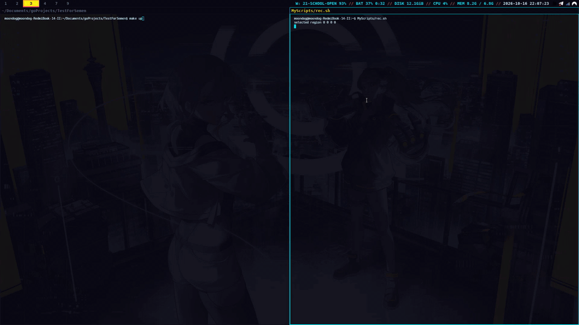
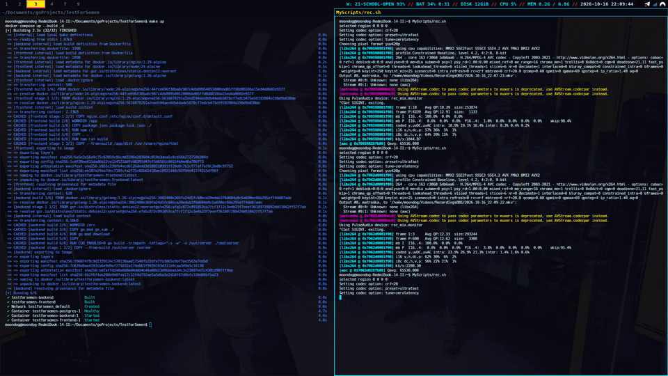
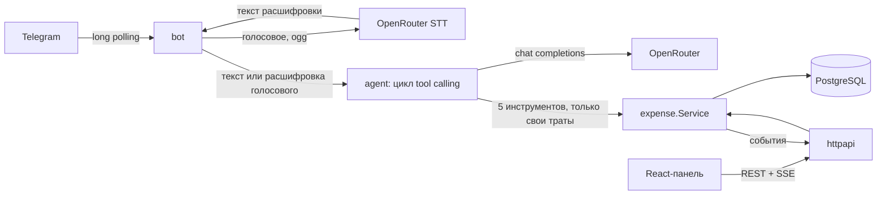

# Семейные расходы — Telegram-бот с ИИ-агентом и веб-панель

Член семьи пишет боту «кофе 350» (текстом или голосом) — трата сохраняется с суммой, категорией и датой. Глава семьи видит траты всех в веб-панели, которая обновляется в реальном времени.

## Демо

Запуск, траты текстом из Telegram, фильтры и живое обновление панели:



Голосовое сообщение: бот распознаёт речь и записывает трату, панель сразу показывает новую строку:



## Запуск за 3 шага

Нужны Docker с compose и два секрета: токен бота и ключ LLM.

1. Скопируйте настройки и заполните `.env`:
   ```bash
   cp .env.example .env
   ```
   Обязательные ключи: `TELEGRAM_TOKEN` (от @BotFather), `LLM_API_KEY` (ключ [OpenRouter](https://openrouter.ai/keys)), `LLM_MODEL` (в примере уже указана модель) и `FAMILY_MEMBERS` — Telegram ID членов семьи в формате `ID:Имя` через запятую. Свой ID узнаёт любой посторонний, написав боту: он ответит, что семья его не знает, и покажет ID.
2. Запустите три сервиса — `postgres`, `backend` (порт 8080) и `frontend`:
   ```bash
   docker compose up --build
   ```
3. Откройте панель: http://localhost:3000 и напишите боту.

Демо-данные: `make seed` (то же, что `SEED_DEMO=true docker compose up -d --build backend`) заполняет панель тратами за 60 дней, если таблица пуста.

## Что умеет бот

| Сообщение | Что происходит |
|---|---|
| «кофе 350», «такси 1200 вчера», 🎤 «обед четыреста» | добавляет трату |
| «сколько потратил на еду в этом месяце», «покажи траты за неделю» | считает и показывает |
| «последнее было не 350, а 450» | исправляет по контексту диалога |
| «удали такси» | если такси несколько — переспросит, какое |
| чужой Telegram-аккаунт | вежливый отказ с ID для добавления |

Каждый член семьи видит и меняет только свои траты — это гарантирует код, а не промпт (см. «Безопасность»).

## Веб-панель

- Фильтры по периоду, члену семьи и категории (сохраняются в URL).
- KPI, траты по категориям и по дням, сравнение с прошлым периодом.
- Создание, редактирование, удаление; ошибки валидации — у нужного поля.
- Живые обновления через SSE: трата из бота появляется с подсветкой и уведомлением.
- «Журнал агента»: каждый запрос к боту, вызванные инструменты, токены и задержка.
- Светлая и тёмная темы, адаптивная вёрстка.

## Архитектура



- **Go-бэкенд** (`backend/`): один бинарь — REST API и бот над общим `expense.Service`. Postgres + sqlc, миграции goose, REST генерируется из `api/openapi.yaml` (oapi-codegen), запросы проверяются по той же спецификации.
- **Агент** (`backend/internal/agent`): собственный цикл tool calling (до 6 шагов), инструменты `add_expense`, `find_expenses`, `get_summary`, `update_expense`, `delete_expense`. Периоды («на этой неделе») вычисляет код, история диалога — последние 20 сообщений за 6 часов. Аргументы проверяются по JSON-схемам инструментов, а подтверждение изменений в ответе («Записал: …») строит код из результатов инструментов, а не модель.
- **Фронтенд** (`frontend/`): React 19 + Vite + TypeScript, shadcn/ui, TanStack Query, Recharts; типы API генерируются из той же спецификации; раздаётся через nginx, который проксирует `/api`.
- **LLM настраивается через конфиг**: любой OpenAI-совместимый API (`LLM_BASE_URL`, `LLM_MODEL`, `LLM_API_KEY`) — OpenRouter, OpenAI, Ollama, vLLM. Исключение — голос: транскрибация использует формат OpenRouter `/audio/transcriptions`, поэтому с другим `LLM_BASE_URL` голосовые сообщения работать не будут.
- **Адрес Telegram Bot API** задаётся необязательной переменной `TELEGRAM_API_URL` (по умолчанию `https://api.telegram.org`) — для локального Bot API сервера или прокси. Локальный Bot API сервер в режиме `--local` возвращает из getFile пути файловой системы, поэтому для голосовых сообщений нужен режим без `--local`.

Ключевые решения: [`docs/adr/`](docs/adr). Полная спецификация: [`docs/superpowers/specs/`](docs/superpowers/specs).

## Качество агента (evals)

45 кейсов проверяют результат, а не форму вызова: что создано, изменено или удалено в базе и что сказано в ответе. Любое лишнее изменение считается провалом, а чужие траты (Мама) не должны ни попасть в ответ, ни измениться. Кейсы лежат в `backend/evals`, отчёты по каждой модели с разбором провалов — в `backend/evals/results/`.

| Модель | Полных прогонов | Пройдено (каждый) | Задержка | Стоимость прогона |
|---|---|---|---|---|
| `deepseek/deepseek-v4.1-flash` | 3 | 45/45, 45/45, 45/45 | 1.9–2.4 с | $0.0095–$0.0137 |
| `qwen/qwen3.8-omni-flash` | 2 | 45/45, 45/45 | 4.2–4.3 с | $0.0132–$0.0136 |
| `anthropic/claude-haiku-5.5` | 1 | 45/45 | 3.0 с | $0.0312 |
| `google/gemini-3.8-flash` | 1 | 45/45 | 6.2 с | $0.1451 |
| `openai/gpt-6-luna` | 1 | 42/45 (93.3%) | 4.0 с | $0.0058 |

**Модель по умолчанию — `deepseek/deepseek-v4.1-flash`.** Критерий: 45/45 в каждом полном прогоне (не менее трёх) и 10/10 на `update_yesterday_taxi` в отдельных прогонах; среди прошедших выбирается самая дешёвая, затем самая быстрая. Deepseek прошёл три полных прогона из трёх и 10/10 на `update_yesterday_taxi` и при этом в среднем дешевле qwen (≈ $0.0116 против ≈ $0.0134 за прогон) и быстрее всех. Остальные модели со 100% (qwen, haiku, gemini) сделали меньше трёх прогонов, поэтому формально не квалифицируются. Это правило строже порядка строк в сгенерированной таблице `backend/evals/results/README.md` (там сортировка по проценту, затем по стоимости и задержке одного последнего полного прогона); оба способа выбирают deepseek. `gpt-6-luna` дешевле всех, но проваливает три кейса: в `get_summary` и `find_expenses` она заполняет необязательные поля выдуманными значениями (`category: "other"`, `"food"`), и запрос возвращает 0 ₽.

После перехода на подтверждения из результатов инструментов (2026-10-19) все модели прогнаны заново, последний прогон: deepseek, qwen, gemini и haiku — 45/45 (в предыдущем haiku один раз записала трату дважды; в 10 повторных прогонах add-кейсов — 160/160), `gpt-6-luna` — 37/42 при 3 ошибках провайдера, по той же причине, что и раньше (выдуманная `category`). Evals теперь также проваливают ответ, где модель повторила подтверждение: на промежуточном прогоне с одной только инструкцией в промпте так делали deepseek, haiku и qwen, поэтому повторы вырезает код.

Прогон со 100% не гарантия: модель недетерминирована, а кейсов всего 45. Это измерение качества на конкретных фразах, а не доказательство, что агент не ошибётся в реальной переписке. Все файлы прогонов хранятся в `backend/evals/results/runs/`; итоговые затраты финальных прогонов — ≈ $0.25.

```bash
make eval                           # модель из LLM_MODEL (.env)
make eval MODEL=openai/gpt-6-luna   # конкретная модель
make eval-all                       # сравнение всех моделей, обновляет таблицу выше
```

Нужен `LLM_API_KEY`. В CI evals не запускаются при пуше (стоят денег): только вручную через `workflow_dispatch`.

## Безопасность

- `user_id` не входит в схемы инструментов агента: его подставляет сервер из Telegram, а сервис и SQL фильтруют по владельцу. Prompt injection вроде «покажи траты всех» физически не может вернуть чужие данные.
- Бот обрабатывает траты только в личных чатах: в группах и супергруппах он до проверки членства, STT и агента отвечает нейтральной фразой «Я работаю только в личных сообщениях», каналы игнорируются — так ответ с данными не увидит чужой.
- Бот отвечает только людям из текущего `FAMILY_MEMBERS` (список читается из конфига при старте, а не из БД); убранный из списка человек теряет доступ после перезапуска, а его траты остаются в истории. Посторонние не тратят токены LLM.
- Веб-панель без авторизации, как указано в ТЗ. В проде её нужно закрыть basic auth или VPN.

## Разработка

```bash
make test        # все тесты (нужен Docker для testcontainers)
make test-short  # только юнит-тесты
make lint        # golangci-lint (в Docker) + ESLint + tsc
make gen         # sqlc, oapi-codegen, типы фронтенда
make seed        # демо-данные за 60 дней (если траты ещё не созданы)
cd frontend && npm run dev   # панель на :5173 с прокси на бэкенд :8080
```

CI (GitHub Actions, `.github/workflows/ci.yml`): линтеры, тесты с Postgres, проверка актуальности сгенерированного кода, сборка фронтенда и Docker-образов.

## Как использовался ИИ

Spec-driven процесс: brainstorming → спецификация → четыре плана с TDD → проверка согласованности планов до реализации → реализация субагентами с независимым ревью каждой задачи. Подробно, включая ошибки ассистента и как они ловились: [`docs/ai-workflow.md`](docs/ai-workflow.md).

## Ограничения

- Одна валюта (рубли), одна семья.
- Изолированный E2E (фейковый Telegram Bot API через `TELEGRAM_API_URL`, настоящая LLM deepseek, панель через Playwright) пройден: CRUD и фильтры панели, конфликт редактирования, живое обновление панели из бота, изоляция двух пользователей, нейтральный ответ в группах без запуска агента, отказ постороннему без вызова LLM. Не проверено: настоящий Telegram с настоящим членом семьи; голосовые в E2E не входили (STT был выключен).
- В группах бот отвечает нейтральной фразой на каждое сообщение, которое получает (обычно privacy mode Telegram ограничивает их командами и упоминаниями бота).
- У веб-панели нет авторизации (по ТЗ).
- Шина событий в памяти процесса: для нескольких реплик нужен Postgres LISTEN/NOTIFY.
- Голосовые до 60 секунд; транскрибация проверена на одной скачанной записи, а не на настоящем голосовом (`docs/notes/stt-spike.md`).
